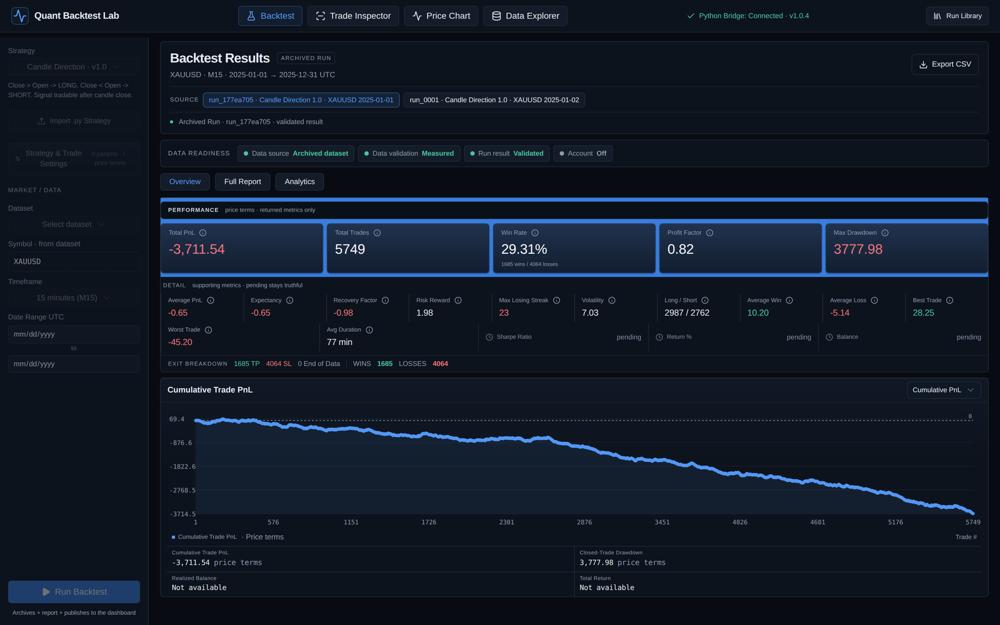
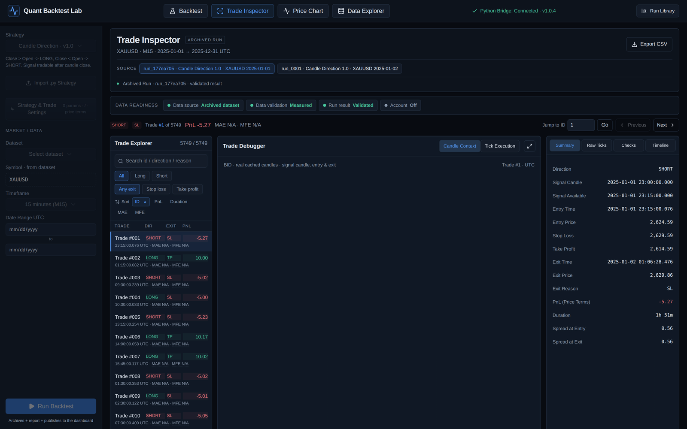
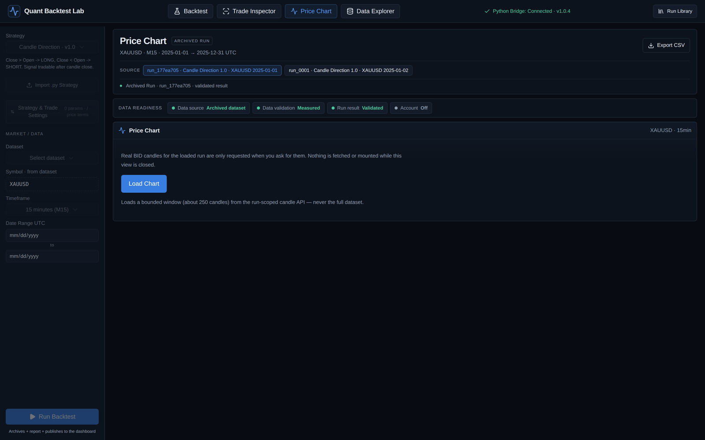
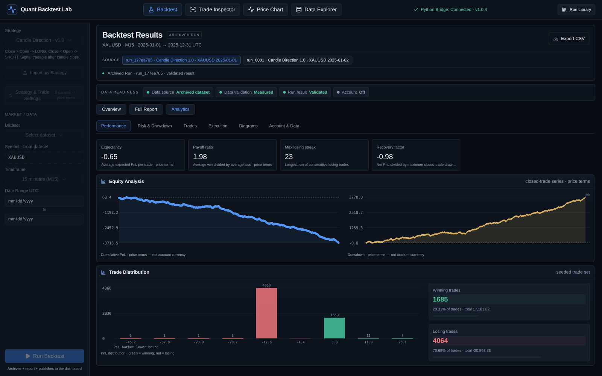

<h1 align="center">Quant Backtest Lab</h1>

<p align="center">
  <b>Tick-accurate backtesting on real BID/ASK data — inspect every trade, trust every fill.</b><br>
  <sub>No synthetic ticks. No mid-price shortcuts. Every position is executed on the market's next real tick.</sub>
</p>

<p align="center">
  
</p>

<p align="center">
  <a href="docs/screenshots/overview.png"></a>
  <a href="docs/screenshots/trade-inspector.png"></a>
</p>

<p align="center">
  <a href="docs/screenshots/price-chart.png"></a>
  <a href="docs/screenshots/analytics.png"></a>
</p>

<p align="center">
  <a href="https://github.com/LeylaKhojasteh/quant-backtesting-system/releases/tag/v1.0.4"></a>
  <a href="https://github.com/LeylaKhojasteh/quant-backtesting-system/blob/main/LICENSE"></a>
  
  
  
  
  
  
</p>

---

## Why this exists

Most backtesters quietly lie. They fill a candle close, they invent a spread, they let a
signal execute on the bar it was derived from. Quant Backtest Lab is built the other way round:

| | This engine |
|---|---|
| **Entry** | LONG fills at **ASK**, SHORT fills at **BID** |
| **Exit** | LONG fills at **BID**, SHORT fills at **ASK** |
| **Spread** | Already inside the fill price — never subtracted twice |
| **Mid price** | Never used, never derived |
| **Signal timing** | Available only **after the source candle closes** |
| **Gap-through SL/TP** | Fills at the **observed** tick price, not the assumed level |
| **Synthetic ticks** | None. Weekends and holidays stay as natural gaps |

> LONG entry at ASK, exit at BID — the spread is baked into the fill, not modelled afterwards.

**Verified reference result** (full year, real Dukascopy data):

```
ticks 71,413,977 · candles 23,638 · trades 5,749 (2,987 long / 2,762 short)
price PnL −3,711.54 · profit factor 0.8224 · max drawdown 3,777.98
```

---

## Try it in 60 seconds — no market data required

A real XAUUSD tick session (Dukascopy, 2024-12-04 UTC) ships with the repo, so you can
run a genuine backtest before you have any data of your own.

```bash
python scripts/install_sample_data.py     # copy the bundled sample into data/
python -m src.data_engine build --all    # build the derived Parquet cache
python -m src.data_engine build-candles  # build the derived candle cache
python -m src.data_engine verify         # exact CSV <-> Parquet parity check
python scripts/start_quant_lab.py        # start the lab
```

Then in the app: pick the **`XAUUSD · SAMPLE`** dataset, keep the auto-filled date range
(**2024-12-04**), and press **Run Backtest**.

What you get, verified on this exact sample:

| | |
|---|---|
| Ticks | **149,220** real BID/ASK ticks |
| Candles | 88 (M15) |
| Trades | **26** with Stop 3 / Take 6 |
| Cache parity | `rows 149220/149220 value=True order=True` |

> The sample registers as its own logical dataset (`xauusd_sample_ticks`), so it can
> never collide with the real monthly files in your own `data/` folder.

### Fetch your own Dukascopy data

The same converter used to build the sample is shipped as a tool:

```bash
python scripts/fetch_dukascopy_ticks.py XAUUSD 2024 12 04 --out data
python scripts/fetch_dukascopy_ticks.py EURUSD 2025 01 06 --hours 8-16 --out data
```

It handles Dukascopy's rate limiting, the per-instrument price scaling (FX uses
5 decimals, metals and JPY crosses use 3) and the hourly timestamp offset — the three
places where a hand-rolled converter usually produces silently wrong prices.

---

## Requirements

| | Version | Note |
|---|---|---|
| **Python** | 3.11+ | `pandas`, `numpy`, `pyarrow` (see `requirements.txt`) |
| **Node.js** | **22.13+** | required by `Quant-Backtest-Lab/package.json` (`engines.node`) |
| **pnpm** | 11.25.0 | `npm install --global pnpm@11.25.0` |

`npm install` also works, but `pnpm` with the committed lockfile is the reproducible path.

---

## Setup

```bash
python -m venv .venv
.venv\Scripts\python.exe -m pip install -r requirements.txt
cd Quant-Backtest-Lab && pnpm install --frozen-lockfile
```

## Start

Double-click **`START_QUANT_LAB.bat`**, or:

```bash
.venv\Scripts\python.exe scripts\start_quant_lab.py
```

- App: **http://127.0.0.1:5173/**
- Engine (API only, no page): **http://127.0.0.1:8765**
- The topbar must read `Python Bridge: Connected · v1.0.4`.

If port 5173 is busy the launcher falls back to 8123 / 12136 / 18000 / 30000 and prints
the URL it actually used.

---

## Your own data

The `data/` folder is **not** in git — it is machine-specific and can be huge. Put one CSV
per symbol, provider and month there:

```
data/
  EURUSD_DUKAS_2025_01_ticks.csv
  EURUSD_DUKAS_2025_02_ticks.csv
  BTCUSD_BINANCE_2025_01_ticks.csv
```

Pattern: `<SYMBOL>_<PROVIDER>_YYYY_MM_ticks.csv`

Two CSV shapes are accepted:

| | Dukascopy shape | Generic shape (crypto, other exports) |
|---|---|---|
| Header | none (auto-detected) | `timestamp,bid,ask` (+ optional `bid_volume,ask_volume`) |
| Time | `YYYY.MM.DD HH:MM:SS.mmm` = UTC | any timestamp parsed as UTC |
| Note | — | single-price exports: copy the price into BOTH `bid` and `ask` (the engine runs on BID/ASK and never invents a spread) |

Rules: never edit files in `data/` afterwards (they are fingerprinted as immutable).
Gaps from weekends/holidays are normal, not corruption. Files named `..._ALL_ticks.csv`
are treated as read-only reference and never used for runs.

### Prepare the cache (once per new data)

```bash
.venv\Scripts\python.exe -m src.data_engine build --all
.venv\Scripts\python.exe -m src.data_engine build-candles
.venv\Scripts\python.exe -m src.data_engine verify
.venv\Scripts\python.exe -m src.data_engine inspect
```

This reads your CSVs, builds a derived Parquet cache under `cache/` (git-ignored,
rebuildable), verifies it bit-for-bit against the CSV source, and registers one logical
dataset per symbol (e.g. `eurusd_dukas_ticks`, `btcusd_binance_ticks`). The dataset then
appears in the app's dataset list.

---

## Run a backtest

1. Sidebar → **Run Setup**: strategy, dataset, timeframe, start/end dates
   (UTC, inside the dataset's coverage).
2. **Strategy & Trade Settings**: strategy inputs, Stop/Take, optional Account Model.
3. Click **Run Backtest**. A live bar shows `● Backtest running · <stage> · mm:ss` with
   the worker heartbeat. The old result stays visible until the new one completes, then
   loads automatically. Reloading mid-run reconnects to the same job.
4. Optional: **Stop Backtest** discards the run (archives and library stay untouched,
   previous result stays on screen).
5. Inspect: price chart, `Cumulative Trade PnL` (or `Realized Account Balance` with the
   Account Model), Trade Explorer, Trade Inspector, Data Explorer, Analytics, Full Report,
   Run Library.

Only one real run at a time — a second start is rejected until the active job finishes
or is stopped.

---

## Account Model (optional)

Price-term results work for every symbol with zero config. For account-currency
PnL/balance/return, the symbol needs economics (quote currency, contract size, tick size).
`XAUUSD/EURUSD/GBPUSD/USDJPY` are built in; anything else (e.g. `BTCUSD → USD, 1.0, 0.01`)
is one entry in `INSTRUMENT_CATALOG` (`src/accounting.py`) or an explicit `instrument` in the
run request. v1 requires quote currency == account currency.

Metrics that cannot be computed stay **Pending** with an explicit reason — they are never
silently shown as zero.

---

## Where things live

- `data/` — your raw CSVs (git-ignored, immutable).
- `data/sample/` — the bundled newcomer sample (committed on purpose).
- `cache/` — derived Parquet (git-ignored, rebuildable).
- `runs/<run_id>/` — `config.json`, `result.json`, `trades.csv`, `equity.csv`,
  `report.html`, `strategy.py` (local, git-ignored).
- `studies/`, `walkforwards/`, `montecarlo/` — research archives (created on first use).
- `Quant-Backtest-Lab/public/` — published results + run manifest.

---

## Commands

```bash
# tests
.venv\Scripts\python.exe -m pytest tests
cd Quant-Backtest-Lab && node scripts/test.mjs

# production build
cd Quant-Backtest-Lab && node scripts/run-framework.mjs build

# sample data
python scripts/install_sample_data.py --list
python scripts/install_sample_data.py --remove
```

---

## Docs

`ARCHITECTURE.md` (source of truth) · `docs/DATA_ENGINE.md` ·
`docs/EXECUTION_MODEL.md` · `docs/STRATEGY_GUIDE.md` ·
`docs/RUN_ARCHIVE.md` · `docs/TEST_HARNESS.md` · `docs/RELEASE_v1.md`

---

## Known v1 limits

- No leverage, margin, swap or slippage model beyond the real BID/ASK prices.
- No Sharpe / Sortino / Calmar / annualized metrics — they stay **Pending**.
- Full-year M15 runs take ~2 minutes (engine-bound).
- Single local user: no auth, no database, no cloud, no live trading.

---

## License

See [`LICENSE`](LICENSE).
